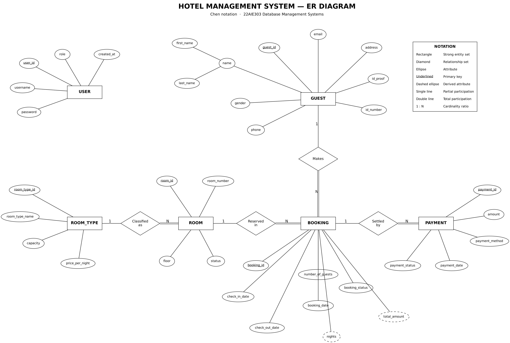
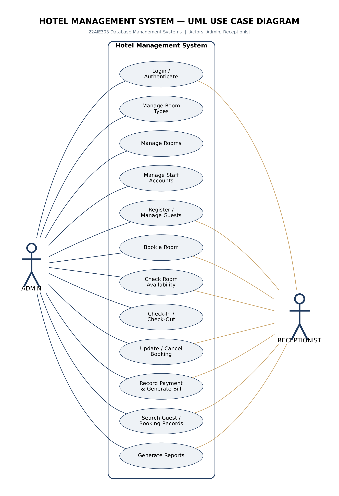

# Hotel Management System

**Course:** 22AIE303 – Database Management Systems  |  **Team:** 03
**Institution:** Amrita Vishwa Vidyapeetham, Coimbatore

| Roll number | Name |
|---|---|
| CB.SC.U4AIE24116 | J. Lakshmi Tejaswi |
| CB.SC.U4AIE24130 | Vishnu Teja |
| CB.SC.U4AIE24135 | Mithul Akshay |
| CB.SC.U4AIE24136 | Mohan Innani |

## 1. Overview and problem statement
Small hotels still keep guest, room and booking records in paper registers. This causes double bookings, slow retrieval, billing errors, no consolidated occupancy view and duplicated data. This project replaces the register with a normalised **MySQL** database and a **Python Tkinter** desktop application. All business rules (overlap checks, billing, room-status changes) live in the database, so the front end cannot bypass them.

## 2. Requirements and architecture
| Layer | Technology |
|---|---|
| Front end | Python 3.10+ with Tkinter (`src/app.py`) |
| Data access | `src/database.py` – every SQL statement is a parameterised function (no SQL in the GUI) |
| Database | MySQL 8.0 – 6 tables, 3 views, 4 triggers, 2 stored procedures, 4 indexes |
| Libraries | `mysql-connector-python` |

```
Tkinter GUI (app.py)  →  data-access layer (database.py)  →  MySQL (tables, views, triggers, procedures)
```
Users: **Admin** (all tabs) and **Receptionist** (day-to-day operations). Passwords are stored as SHA-256 hashes.

## 3. ER diagram and UML
* Chen-notation ER diagram: `diagrams/ER_Chen.pdf` / `.png` (6 entities; PAYMENT is a strong entity)
* UML use-case diagram: `diagrams/Use_Case_Diagram.pdf` / `.png`
* Both are generated from `diagrams/er_chen.py` and `diagrams/use_case.py` (Graphviz).




## 4. Relational schema
```
USERS      (user_id PK, username UNIQUE, password, role, created_at)
ROOM_TYPES (room_type_id PK, room_type_name UNIQUE, capacity, price_per_night)
ROOMS      (room_id PK, room_number UNIQUE, room_type_id FK→ROOM_TYPES, floor, status)
GUESTS     (guest_id PK, first_name, last_name, gender, phone UNIQUE, email, address, id_proof, id_number, UNIQUE(id_proof,id_number))
BOOKINGS   (booking_id PK, guest_id FK→GUESTS, room_id FK→ROOMS, check_in_date, check_out_date, number_of_guests, booking_date, booking_status)
PAYMENTS   (payment_id PK, booking_id FK→BOOKINGS, amount, payment_method, payment_date, payment_status)
```
Full DDL (PK, FK, CHECK, UNIQUE, NOT NULL, ENUM, DEFAULT, ON DELETE/UPDATE rules): `database/01_schema.sql`.

## 5. Normalization and functional dependencies
The unnormalised booking register suffers update, insertion and deletion anomalies. It was decomposed through 1NF → 2NF → 3NF → BCNF: guest details depend only on the guest, tariff only on the room type, room attributes only on the room, payments on the payment id. Every determinant is a candidate key, so **all six relations are in BCNF**. Derived values (`nights`, `total_amount`) are computed by the view/procedure and are not stored. `PAYMENTS.amount` is deliberate, documented redundancy (the amount actually paid, which may differ from today's tariff). See report Section 5.

## 6. Methodology
Requirement analysis → conceptual design (ER) → logical mapping to relations → normalization → physical design (constraints, indexes, views) → advanced SQL (triggers, procedures) → Tkinter front end → testing → documentation.

## 7. Advanced SQL implemented and its purpose
`database/advanced_queries.sql` holds 11 documented queries; real output is in `database/advanced_queries_output.txt`.

| # | Feature | Purpose |
|---|---|---|
| Q1 | 4-table JOIN | Booking register with nights and bill |
| Q2 | Subquery (NOT IN) + overlap test | Rooms free for a date range |
| Q3 | Correlated subquery (EXISTS) | Guests with pending payments |
| Q4 | GROUP BY + HAVING + SUM | Revenue by room type above a threshold |
| Q5 | Conditional aggregation | Occupancy % per room type |
| Q6 | Scalar subquery | Bookings above the average bill |
| Q7 | LEFT JOIN … IS NULL | Rooms never booked |
| Q8 | Window function RANK() | Guest ranking by amount paid |
| Q9 | View | Live bookings through `vw_booking_details` |
| Q10 | Stored procedure | `CALL sp_generate_bill(id)` itemised bill |
| Q11 | Transaction / ROLLBACK | Atomicity demonstration |

Triggers: `trg_after_booking_insert / _update / _delete` call `sp_refresh_room_status` (room is *Occupied* only while a Checked-In booking exists; *Maintenance* is never overwritten); `trg_before_guest_delete` removes a guest's bookings first, because MySQL does not fire triggers on `ON DELETE CASCADE`.

## 8. Installation, setup and run
Prerequisites: MySQL 8.0 server, Python 3.10+ (with Tkinter), `pip install mysql-connector-python`.

```bash
# 1. create and populate the database (schema + sample data + views + triggers + procedures)
mysql -u root -p < database/01_schema.sql
# 2. (optional) run the documented advanced queries
mysql -u root -p hotel_db < database/advanced_queries.sql
# 3. set your MySQL password
#    edit src/db_config.py  ->  "password": "<your password>"
# 4. start the application
python src/app.py
```
Logins: `admin` / `admin123` and `reception` / `admin123`.
Troubleshooting: *Access denied* → fix the password in `db_config.py`; *Unknown database* → repeat step 1; *No module named tkinter* → install `python3-tk`.

## 9. Demonstration steps
1. Log in as `admin`; the Dashboard shows six aggregate counts.
2. **Guests** → add a guest (try a duplicate phone: the UNIQUE constraint rejects it).
3. **Bookings** → *Find Available Rooms*, then book; try an overlapping booking: blocked.
4. Select the booking → **Check-In**: the room becomes *Occupied* (trigger). **Check-Out**: it becomes *Available*.
5. **Payments** → pick the booking, *Auto-Calculate Bill* (stored procedure), add the payment.
6. **Reports** → run the four aggregate reports.
7. **Room Types** → delete a type that still has rooms: the foreign key (RESTRICT) refuses it.
More detail and viva questions: `docs/SETUP_AND_DEMO_GUIDE.md`.

## 10. Testing and validation
| Test | How to run | Result |
|---|---|---|
| GUI end-to-end (18 checks: CRUD, constraints, triggers, billing, reports) | `xvfb-run -a python tests/e2e_gui_test.py` | 18 / 18 pass (`tests/e2e_results.txt`) |
| Trigger scenarios (8) | `mysql -u root -p < tests/trigger_tests.sql` (reload the schema afterwards) | all pass (report §6.13) |
| Advanced queries | `mysql -u root -p hotel_db < database/advanced_queries.sql` | output in `database/advanced_queries_output.txt` |

Tests were run on a MySQL-compatible server (MariaDB 10.11); the schema only uses MySQL 8.0 features.

## 11. Repository layout
```
database/      01_schema.sql, advanced_queries.sql, advanced_queries_output.txt
src/           app.py, database.py, db_config.py
diagrams/      ER and use-case diagrams (+ generator scripts)
docs/          project report (PDF), final presentation (PPTX), setup & demo guide
screenshots/   application screenshots
tests/         e2e_gui_test.py, trigger_tests.sql, e2e_results.txt
```

## 12. Limitations and future scope
Role-based screen restrictions and a staff-account screen are not yet in the GUI; double-booking prevention is in the application layer (a DB-level check would be stronger); booking+payment are separate commits. Future work: role enforcement, transactions, PDF invoices, analytics dashboard, web front end.
